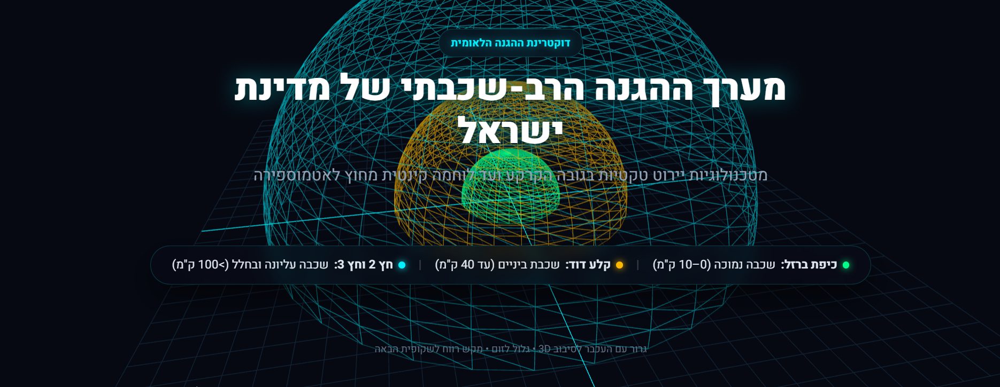
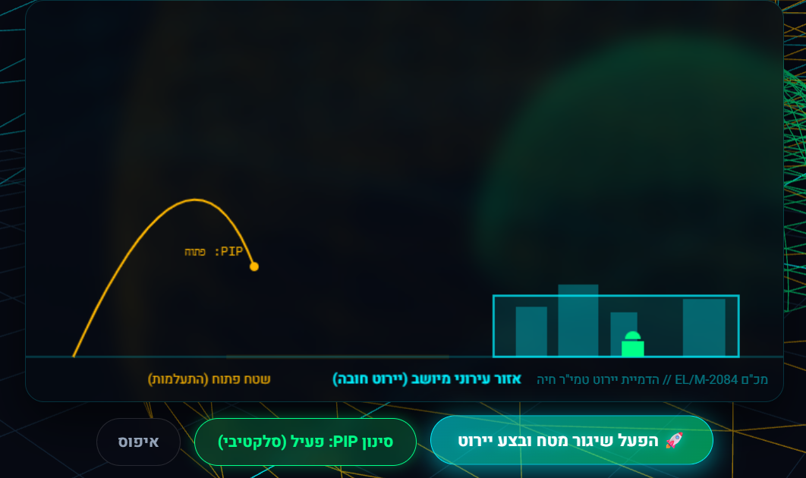
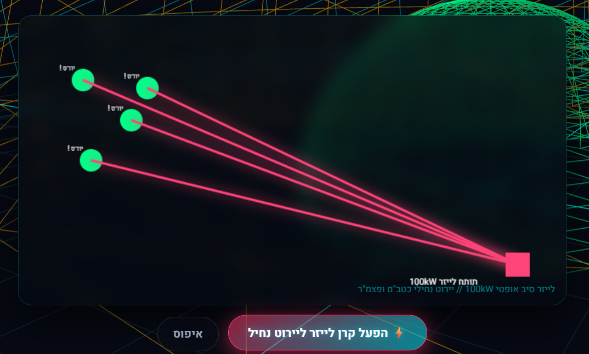

# מערך ההגנה הרב-שכבתי של מדינת ישראל

מצגת טכנולוגית אינטראקטיבית ומודרנית המציגה את מעטפת ההגנה האווירית והרקטית של ישראל.

## 📸 תצוגת המצגת והסימולטורים

### 1. שקופית 3D ראשי - תצוגת כיפות ההגנה

### 2. סימולטור יירוט סלקטיבי - כיפת ברזל (אלגוריתם PIP)

### 3. סימולטור לייזר - מגן אור (תותח 100kW)

## 🚀 רכיבי המערכת במצגת
- **כיפת ברזל:** הגנה טקטית לטווח קצר.
- **קלע דוד:** הגנה לטווח בינוני-ארוך.
- **חץ 2 וחץ 3:** הגנה אקסו-אטמוספרית בחלל.
- **מגן אור:** מערכת יירוט בלייזר.

## 🛠️ טכנולוגיות
- HTML5 & CSS3 (Frosted Glassmorphism Layout).
- JavaScript ES6 & Three.js (מנוע 3D לכיפות ההגנה).
- Interactive Canvas Simulators.

## 📄 מסמכי הפרויקט
- TRD.md: מפרט דרישות טכניות ותכנון ארכיטקטורה.
- prompts.md: תיעוד תהליך העבודה והפרומפטים מול ה-AI.
